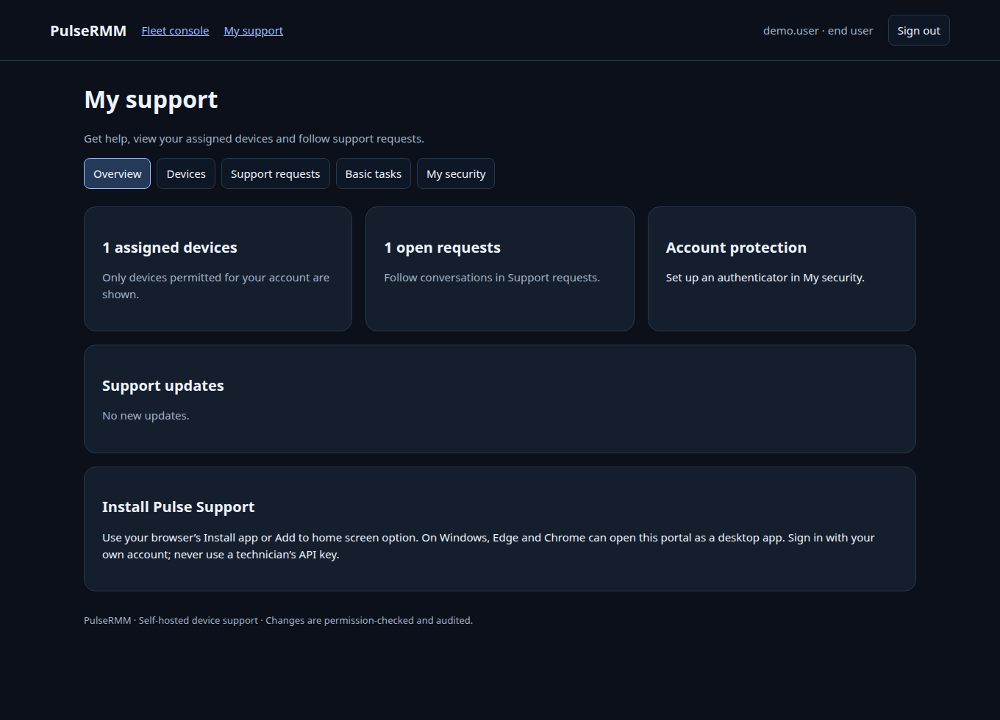
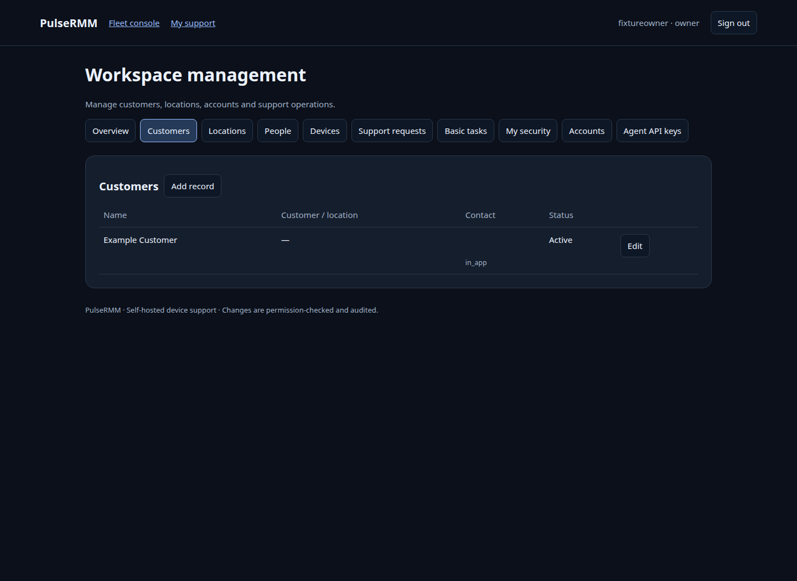

# PulseRMM

Self-hosted remote monitoring and IT support by HumbleMind AI Labs. Apache-2.0 licensed source; run your own instance or build a managed-instance offering through CloudMonkey. Automated CloudMonkey self-service provisioning and billing are roadmap integrations, not implemented in this release.

## Capabilities

- Windows, Linux and macOS monitoring agents; CPU, memory, disk, networking, processes, services and bounded warning/error history. Agents report an initial snapshot on connection and then every 60 seconds by default. CPU core frequencies, exposed temperature sensors, boost state and OS thermal-throttle counters are best-effort and report as unavailable when the platform or hardware does not expose them.
- Operator console, remote command jobs, RustDesk handoffs, alert rules, maintenance records and audit history.
- Durable user accounts: owner, administrator, technician, customer administrator, viewer and end user. Customer-scoped accounts cannot enter unrestricted legacy fleet routes.
- Authenticator-app two-factor authentication, encrypted factor seeds, one-use recovery codes, password changes and revocable, idle-expiring sessions.
- Customers, locations, people/contact preferences and audited device/end-user assignments.
- Support tickets, replies, internal notes, private bounded attachments and in-app notifications.
- Browser-installable Pulse Support portal with device visibility based on account assignment. Updated GUI-device agents add a support shortcut; no fleet credential is embedded in the portal.
- Explicit AI support requests using a configured OpenAI model. Only visible support conversation text is sent after consent. AI never dispatches commands. Human support works without an AI key.
- Allowlisted basic diagnostic requests with a separate operator approval, bounded task definitions and job tracking.
- Individually named, scoped, customer-restricted, expiring/revocable service API keys; API specification and examples included.

## Self-host with Docker

Requirements: Docker Engine with Compose, a Linux host, persistent disk, a DNS name and an HTTPS reverse proxy. Never expose the development HTTP listener directly to the Internet.

```sh
git clone https://github.com/geek247-amzo/pulse-rmm.git
cd pulse-rmm
python3 scripts/configure.py --url https://rmm.example.com --admin owner
docker compose up -d --build
```

The setup script creates `.env` with mode 0600; it never prints passwords or secrets. Retrieve the generated initial administrator password locally using your secure editor. Put Caddy/Nginx in front of `127.0.0.1:8080`. A Caddy example:

```caddyfile
rmm.example.com {
    reverse_proxy 127.0.0.1:8080
}
```

Open your HTTPS domain and sign in. Use **Settings → Two-factor authentication** to scan the authenticator QR code and save recovery codes; the account portal also retains a manual setup-key fallback. Keep a protected backup of the data directory, including `account-encryption.key`; losing that key prevents factor decryption. MFA becomes required for each account once its enrollment is confirmed; deployment does not silently enable it before the owner enrolls.

The default Compose file only publishes loopback HTTP. A proxy on another machine needs an explicitly chosen private bind address and firewall rule. That private hop is HTTP: use native TLS or another encrypted transport if the private network is not trusted.

## Management and support

- Fleet console: `/`
- Accounts, customers, locations, people and scoped keys: `/manage.html`
- End-user support application: `/support.html`
- Expanded management API: `/api/v1/`; discovery/identity: `/api/v1/status`
- OpenAPI: `/openapi-v1.json` (expanded API), `/openapi.yaml` (legacy compatibility API)

Create customers and locations, create each end user's own account and assign devices to the correct customer/location/person/account. Contacts do not automatically receive portal login access. In-app notifications are implemented; email/SMS/WhatsApp delivery adapters are not configured by this project. Recording a preferred channel or phone number does not send messages or establish consent.

Use one scoped API key for each approved Hermes profile or other integration. New keys never fall back to unrestricted legacy routes. Empty customer restrictions mean global access and must be selected deliberately. Scope-free keys cannot be issued. See [API guide](docs/MANAGEMENT-API.md).

## Device application and enrollment

Use the fleet console to create a short-lived, single-use enrollment download for an OS/architecture. New binary downloads use the configured HTTPS origin and encrypted WebSocket endpoint. A Windows desktop link, Linux application-menu link or macOS browser link opens the support portal; users still authenticate individually. The portal can also be installed through a supported browser's Install app action. Native tray support and OS-specific device-app validation remain separate rollout work.

Existing devices continue using their enrolled identities. They do not automatically receive a new binary: redeploy updated agents deliberately and test on representative machines. New agent downloads use the configured `PUBLIC_URL` HTTPS origin and connect to its `/ws/agent` endpoint over WSS. No unattended command is sent merely by updating the server. Remote diagnostics run with the agent process's OS permissions; end users and AI do not receive an arbitrary shell.

RustDesk is optional and separately licensed. Configure its private server address and public key in Settings if wanted. Upstream installers are downloaded from checksum-pinned official releases; no RustDesk binary or private server key is distributed in this release. Read [third-party notices](THIRD_PARTY_NOTICES.md).

## Development and verification

Go 1.23 is the source minimum; CI and release builds use a current stable Go toolchain.

```sh
cd server
go test ./...
go vet ./...
```

See [architecture](docs/ARCHITECTURE.md), [security](SECURITY.md), [upgrade/rollback](docs/DEPLOYMENT.md), [roadmap](ROADMAP.md), and [release notes](CHANGELOG.md). The feature plan includes future work and is not a statement that every planned item ships in this version.

## Private source and public releases

Development history and private operator documentation are maintained in a separate private repository. Public releases include buildable source, agent source, deployment examples, API contracts, license and release checksums. Customer records, monitoring data, credentials, generated downloads/enrollment tokens, private keys and deployment-specific operational records are excluded from both Git repositories.

## Screenshots

These examples contain synthetic demonstration records only.





For the browser workflow against a disposable instance (no production state):

```sh
npm ci
npx playwright install chromium
docker build -t pulse-rmm:dev server
sh scripts/browser-fixture.sh
```

The fixture tests use synthetic customers, users and one simulated device; they test account/MFA, assignment, support messages/attachments, approvals and scoped-key boundaries. They must never target a production instance.

## Release downloads

GitHub Releases include source archives, a Linux amd64 Docker image archive and base agent binaries for five OS/architecture targets, with SHA-256 checksums. Base agents are not pre-enrolled installers; use your own instance's enrollment flow.

To use the prebuilt Linux amd64 server image, extract the source archive, verify the downloaded assets against `SHA256SUMS`, then run:

```sh
docker load -i pulse-rmm-0.2.0-linux-amd64-image.tar.gz
python3 scripts/configure.py --url https://rmm.example.com --admin owner
docker compose -f docker-compose.yml -f compose.release.yml up -d --no-build
```

The image contains no runtime credentials or customer data. Other server architectures can build from source. Configure HTTPS and enroll MFA as described above.
